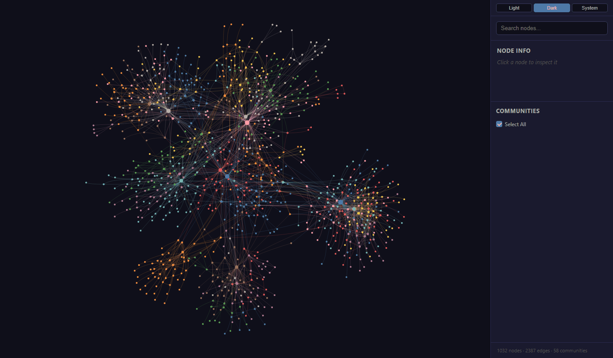

<p align="center">
  
</p>

<h1 align="center">Graphify for Claude Code</h1>

<p align="center">
  <b>Turn any project into a knowledge graph Claude can query.</b><br>
  Claude asks the graph before it greps, so it finds the right files and cites them, with far fewer tokens.
</p>

<p align="center">
  <a href="#install">Install</a> ·
  <a href="#see-it">See it</a> ·
  <a href="#use">Use</a> ·
  <a href="#how-it-works">How it works</a> ·
  <a href="#other-apps">Other apps</a> ·
  <a href="#faq">FAQ</a>
</p>

<p align="center">
  
  
  
</p>

---

[Graphify](https://github.com/Graphify-Labs/graphify) turns a folder of code, docs, papers, images or videos into a knowledge graph: the files, functions and ideas, how they connect, and which clusters they form. This plugin brings it to Claude Code:

- **Builds the graph.** `/graphify .` maps your project into `graphify-out/`.
- **Asks the graph first.** Before Claude greps or reads files, it's pointed to `graphify query`, which returns just the files and relations that matter.
- **Cites its sources.** Answers come with file and line.
- **Installs like any plugin.** One command to add, update or switch off; no files copied into your config.

> [!NOTE]
> Unofficial. Not made by or affiliated with the Graphify authors. The skill files are theirs, copied unchanged.

## Install

**1. Install Graphify** (Python 3.10+). The `mcp` extra is needed for `graphify query` in 0.9.118:

```bash
pip install -U "graphifyy[mcp]"
```

Check that `graphify --help` works in your terminal. On Windows, `pip install --user` puts it in `%APPDATA%\Python\Python3xx\Scripts`; add that folder to your PATH.

**2. Add the plugin** in Claude Code:

```
/plugin marketplace add kramund/graphify-plugin
/plugin install graphify@graphify-plugin
```

**3. Restart Claude Code.**

> [!IMPORTANT]
> Use this plugin **or** `graphify install`, not both: you'd get the skill twice and every hook would run twice. If you used the installer before, run `graphify uninstall` first.

## See it

<p align="center">
  
</p>
<p align="center"><sub>The interactive <code>graph.html</code> Graphify writes, here for 11 of its own modules (1,032 nodes, 58 communities).</sub></p>

## Use

| Ask Claude | What happens |
|---|---|
| `/graphify .` | Builds the graph of the current project into `graphify-out/` |
| Any question about the code | Claude runs `graphify query` first, then reads only the files it names |
| `/graphify path "A" "B"` | The shortest chain of relations between two things |
| `/graphify explain "X"` | A plain-language summary of one node and its neighbours |
| `/graphify . --update` | Re-extracts only new or changed files |

Keep the graph current after code changes with `graphify update .` (no AI needed), or ask Claude to set up the git hooks that do it on every commit (`graphify hook install`).

## How it works

| Part | Does |
|---|---|
| `graphify` skill + 8 reference files | The full workflow: build, update, query, path, explain, exports |
| Hook before Bash and Grep | In a project with a graph, points Claude to `graphify query` before it searches |
| Hook before Read and Glob | Shows what the graph already knows about the file or pattern |
| Hook after a compaction | Restates the graph once the earlier reminders are gone |

These are the hooks `graphify install` sets up for Claude Code. They stay silent in projects without a graph, and do nothing if Graphify isn't installed.

## Other apps

This plugin is for Claude Code. For Codex, Cursor, Gemini CLI, Copilot and others, use Graphify's own installer, which has a version for each:

```bash
graphify install --platform codex   # or cursor, gemini, copilot, …
```

## FAQ

**Does it send my code anywhere?** Code is mapped locally with no AI and no key, and so is `graphify update`. Docs, papers and images are read by Claude itself in your session, unless `GEMINI_API_KEY` or `GOOGLE_API_KEY` is set, in which case Graphify sends them to Gemini. It reads no other API key.

**Where is the graph?** In `graphify-out/` in your project. Commit it if your team should share it.

**How is this kept up to date?** `scripts/update.sh` copies the latest skill files from Graphify's `v8` branch and records the commit in `UPSTREAM`; the version is bumped and released through a pull request.

**`graphify: command not found`.** Graphify is installed but not on your PATH; see step 1. The hooks fall back to `python -m graphify`, but the skill's commands need `graphify`.

## Licence

Graphify is © 2026 Safi Shamsi and the Graphify contributors, under the Apache License 2.0 (`LICENSE`), with earlier parts under MIT (`LICENSE-MIT`); see `NOTICE`. This repo is under the same Apache License 2.0. The skill and reference files are unmodified copies from the commit in `UPSTREAM`; the manifests, hook wrapper, update script, tests and images were added here.
